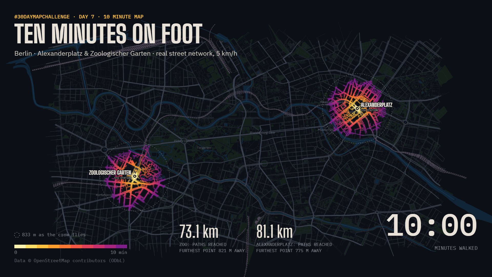

# Ten Minutes on Foot

**#30DayMapChallenge 2026 · Day 7 · 10 minute map**

How far can you walk in 10 minutes from Berlin's two big S-Bahn hubs, **Alexanderplatz** in the east and **Zoologischer Garten** in the west? This animated map spreads out along the real street network, minute by minute, until the 10 minutes are up.



- **Interactive map:** [`index.html`](index.html). Open it in a browser, or view it live on GitHub Pages (see below).
- **Video (1920×1080, MP4):** [`berlin-10-minute-walk.mp4`](berlin-10-minute-walk.mp4)

## What the map shows

| Station | Paths & sidewalks reached | Furthest point (straight line) |
|---|---|---|
| Zoologischer Garten | 73.1 km | 821 m |
| Alexanderplatz | 81.1 km | 775 m |

- Streets are colored by walking time from the station, from pale yellow (0 min) to purple (10 min).
- The dashed circle shows 833 m as the crow flies, the distance you would cover in 10 minutes if there were no streets in the way. The gap between the circle and the colored network shows how much the city's layout slows you down: rivers, rail lines, the zoo and blocks without through-paths.

## Method

1. **Data:** streets, footpaths, water, parks and rail lines from OpenStreetMap, downloaded through the Overpass API (`scripts/fetch.py`).
2. **Network:** every walkable way (footways, paths, pedestrian zones, residential to primary roads, steps, etc.) becomes an undirected graph. Ways tagged `foot=no` or private access are excluded. Motorways are excluded.
3. **Walking distance:** Dijkstra's shortest path from all network nodes within 70 m of each station, cut off at **833 m**, which is 10 minutes at **5 km/h** (`scripts/process.py`).
4. **Animation:** an HTML canvas reveals each street segment from both ends as the walking distance grows, so the colors spread the same way a walker would (`scripts/template.html`).

Known simplifications: walking speed is constant, waiting at traffic lights is ignored, and open pedestrian squares are only crossable along mapped paths.

## Rebuild it yourself

Requires Python 3 (standard library only).

```bash
python scripts/fetch.py data/berlin.json
python scripts/process.py data/berlin.json data/mapdata.js
python scripts/build.py scripts/template.html data/mapdata.js index.html
```

To use other stations, edit the `STATIONS` list and the bounding box in `scripts/process.py` and `scripts/fetch.py`.

When `index.html` is opened directly in Chrome or Edge, a **Save video** button records a 1920×1080 `.webm` of the animation.

## Live page with GitHub Pages

In the repository, go to **Settings → Pages**, choose **Branch: main** and **/ (root)**, and save. The map will be published at `https://<your-username>.github.io/<repository-name>/`.

## Credits

Map data © [OpenStreetMap](https://www.openstreetmap.org/copyright) contributors, available under the Open Database License (ODbL).
Fonts: Big Shoulders Display and IBM Plex, via Google Fonts.
